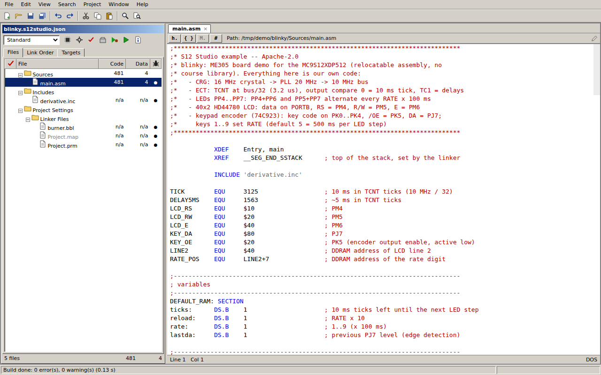
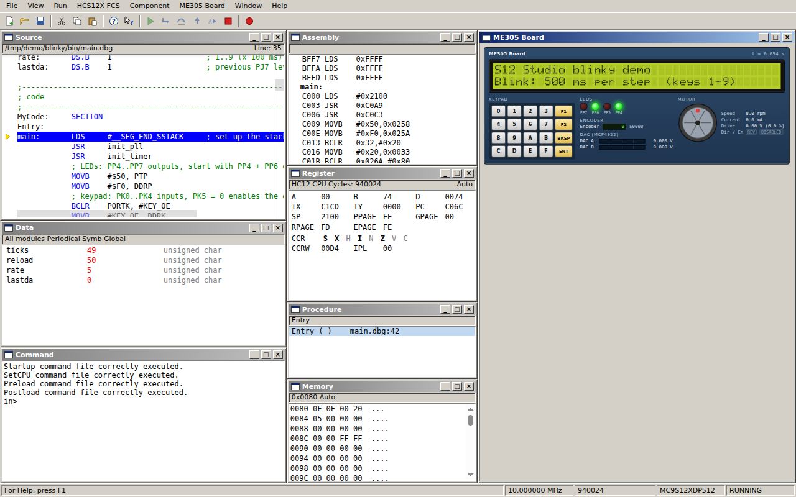

# S12 Studio

**Write, build and debug MC9S12XDP512 assembly on your own laptop, the way you do on the ME 305 lab PCs.**

S12 Studio is a free, open-source desktop app for Cal Poly ME 305 (HCS12X / MC9S12XDP512, assembly). It works like
the lab's CodeWarrior for S12(X) v5.1 and its simulator/debugger (hiwave): it opens CodeWarrior-format
projects (`.mcp`), assembles and links them to the same output files byte for byte, and runs them in a full-chip
simulator with an on-screen ME 305 benchtop board (LCD, keypad, LEDs, motor and encoder), at real speed.




> S12 Studio is an independent student project. It is not affiliated with or endorsed by NXP; CodeWarrior is a
> trademark of NXP B.V. See [NOTICE](NOTICE).

## Download

| | |
|---|---|
| **Windows 10/11 (x64)** | [`S12Studio-<version>-win-x64-setup.exe`](https://github.com/bigPowder1/s12studio/releases/latest) |
| **macOS (Apple Silicon or Intel)** | [`S12Studio-<version>-mac-arm64.dmg`](https://github.com/bigPowder1/s12studio/releases/latest) for M-series Macs, `...-mac-x64.dmg` for Intel |
| **Linux (x64)** | [`S12Studio-<version>-linux-x86_64.AppImage`](https://github.com/bigPowder1/s12studio/releases/latest) |

All downloads are on the [latest release page](https://github.com/bigPowder1/s12studio/releases/latest). Download page with
pictures: <https://bigpowder1.github.io/s12studio/>.

## Installing (beta builds are not code-signed yet)

The beta installers are not signed with a paid certificate, so Windows and macOS show a warning the first time.
This is expected. Full guide with screenshots: [install guide](https://bigpowder1.github.io/s12studio/install.html).

- **Windows:** run the installer (per-user install, no administrator rights needed). If "Windows protected your PC" (SmartScreen) appears, click **More info**, then
  **Run anyway**. On PCs with **Smart App Control** turned on, Windows may block unsigned apps with no "Run anyway"
  option; use a lab PC or wait for the signed release in that case. Windows installs update themselves.
- **macOS:** open the `.dmg` and drag S12 Studio to Applications. The first launch is blocked ("Apple could not
  verify..."). Click **Done**, open **System Settings > Privacy & Security**, scroll down and click **Open Anyway**,
  then confirm. You only do this once. Mac builds do not update themselves yet: the app tells you when a new
  version is out and opens the download page.
- **Linux:** `chmod +x S12Studio-*.AppImage` and run it (needs FUSE 2: package `libfuse2t64` on Ubuntu 24.04+, `libfuse2` on 22.04).

## Quick start

1. **Open your lab project:** copy the `blank_project` folder ME 305 gives you (course page), then **File > Open...**
   and pick its `.mcp`. S12 Studio does not include the course library or template; they come with your course's
   project folder. Work on a copy: building writes `bin/` and object files next to the project, as CodeWarrior does.
2. **Build:** press **F7** (Project > Make). Errors appear in the Errors & Warnings window; double-click to jump
   to the line.
3. **Debug:** press **F5** (Project > Debug). The debugger window opens with your program loaded into the
   full-chip simulator and the ME305 Board panel docked on the right (F5 builds first if anything changed).
4. **Run:** press **F5** again (Run > Start). Click the board's keypad to type; F6 halts, F11 single-steps, F10
   steps over. Breakpoints: click in the Source window's margin.

No course project yet? Open the demo project (**Help > Open Demo Project**, or from the startup dialog) to see the
board's LCD, LEDs and keypad in action, or use **File > New Project** for an empty assembly project (without the
ME 305 library). The demo's source is in [`examples/blinky`](examples/blinky/).

## FAQ

**Where do I get the ME 305 library / blank project?** From your course: they are in the `blank_project` folder ME 305
gives you (course page). S12 Studio does not include course material; copy that folder and open its `.mcp` with
File > Open... . To list it in File > New Project as well, copy the `blank_project` folder into the `templates`
folder of S12 Studio's user-data folder (the New Project dialog shows the exact path).

## What works

- CodeWarrior S12(X) v5.1-style IDE: project window, editor with HC12 assembly highlighting, Make (F7), Errors &
  Warnings, Target Settings, New Project.
- Assembler, linker and burner whose `.lst`, `.map`, `.abs` and `.s19` match CodeWarrior's.
- hiwave-style debugger: Source, Assembly, Register, Memory, Data, Procedure, Command and Terminal windows,
  breakpoints and watchpoints, stepping, the debugger command language and `.cmd` files.
- Full-chip MC9S12XDP512 simulation in real time (timers, interrupts, SCI, SPI, ATD, PWM, flash/EEPROM...) plus the
  ME 305 board.
- Everything runs locally; nothing is uploaded and no account is needed.

## Known gaps

- **Simulator only.** Programming and debugging the real lab board with the P&E Multilink pod is planned for
  Release 2 (Windows only). For now, flash the real board on a lab PC.
- **Mac:** simulator only, now and later (the P&E pod's driver is Windows-only).
- Some CodeWarrior extras are missing or disabled: help system (F1 shows the keyboard shortcuts), workspaces,
  code completion, compare files, the Clock Frequency / Set Derivative dialogs. Editor documents are tabs rather
  than separate windows.
- More in [docs/STATUS.md](docs/STATUS.md).

## Reporting bugs

Open an issue: <https://github.com/bigPowder1/s12studio/issues/new>. Please include your OS, the S12 Studio version
(Help > About), what you did, what you expected and what happened. If a build or simulation differs from the lab
PC, attach a small project that shows it (and, if you can, the lab PC's `.lst`/`.map` output). Do not post graded
lab solutions publicly; a cut-down example is enough.

## Building from source

Requirements: Node.js 22 and npm.

```bash
npm ci                                  # install
npx vitest run                          # unit + golden tests
npx tsc -p tsconfig.json --noEmit       # typecheck engine packages
npm run typecheck -w @s12/ide           # typecheck the app
npm run app                             # build and start the app
npm run app:e2e                         # Playwright end-to-end tests
```

Installers are built with electron-builder (`npm run dist:win`, `dist:mac`, `dist:linux`, output in `apps/ide/dist/`;
see [docs/RELEASING.md](docs/RELEASING.md)). On WSL/Linux without `libasound`, see [apps/ide/README.md](apps/ide/README.md).

Layout: `packages/*` are the engine (pure TypeScript, no Electron: `formats`, `isa`, `asm`, `link`, `sim`, `debug`,
`project`, `devices`, `hw`), `apps/ide` is the Electron app, `examples/` holds demo projects, `docs/` has the plan,
status and research notes. See [CONTRIBUTING.md](CONTRIBUTING.md).

### Private fixtures (maintainers)

Byte-for-byte "golden" tests compare our output with real CodeWarrior output from course projects. Those projects
(and the ME 305 library) are not public; they live in a private repository checked out at `fixtures/` (ignored by
git here), or anywhere you point `S12_FIXTURES` at. Without them the golden tests are skipped and everything else
runs. The public CI never sees them; the golden suite runs in the private repository's own workflow
([`docs/ci/fixtures-golden.yml`](docs/ci/fixtures-golden.yml), see [docs/RELEASING.md](docs/RELEASING.md)).

## License

Apache License 2.0 ([LICENSE](LICENSE)). Third-party material: [THIRD_PARTY_NOTICES.md](THIRD_PARTY_NOTICES.md).
S12 Studio contains no ME 305 course material; the course's project files and library belong to their authors.
